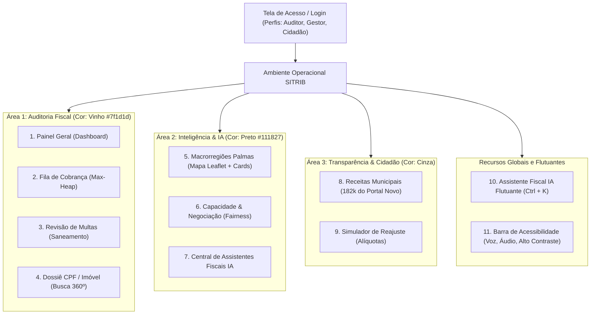

# 📘 Explicação Detalhada do Sistema — SITRIB Palmas (Tela a Tela, Agentes, Cálculos em R$ e Arquitetura)

**Sistema de Inteligência Tributária (SITRIB) — Prefeitura Municipal de Palmas / SEFIN**  
**Projeto Integrador: Inteligência Tributária e Engenharia de Software — UFT**  
**Autoria:** Adriel Morais (PO), Gabriel Lopes (SM), João Pedro Figueredo (Dev), Rayssa de Oliveira (Dev)  

---

## 1. 💰 O que significa a IA "Redigir a Resposta em R$"?

Quando dizemos que o Agente de IA **"redige respostas em R$"**, significa que a Inteligência Artificial **não se limita a dar conselhos genéricos ou teóricos** (como *"você deve cobrar o devedor com rigor"* ou *"tente um acordo amigável"*).

Na prática, o agente:
1. **Lê o valor exato no banco de dados (PostgreSQL):** Pega o valor original do débito, a multa, os juros acumulados e o valor venal do imóvel cadastrado em Palmas.
2. **Cruza com o Censo IBGE daquele bairro específico:** Puxa a renda média familiar da região (ex: R$ 2.080,00 no Aureny ou R$ 5.400,00 no Plano Diretor Sul).
3. **Calcula a matemática financeira na hora:**
   * Aplica a **Razão Dívida / Patrimônio**: se a dívida for inferior a 3% do valor venal de um imóvel de R$ 4 milhões, comprova que há liquidez e que o devedor tem dinheiro para pagar.
   * Aplica a **Regra Ética do Comprometimento de Renda**: em áreas vulneráveis, a parcela não pode ultrapassar **10% da renda familiar** (para não comprometer a alimentação e o mínimo existencial da família).
4. **Redige uma proposta formal com valores monetários explícitos (R$):**
   * *Exemplo real gerado pela IA no Aureny:*  
     > *"O contribuinte aufere R$ 1.412,00 (1 salário mínimo) e deve R$ 2.000,00 de IPTU. Ajuizar custaria R$ 4.500,00 ao município. Proposta da IA: aplicação do REFIS Social com 95% de desconto em juros/multas, fixando a entrada em R$ 100,00 e o saldo em parcelas de até R$ 141,20 mensais (teto de 10% da renda), resguardando a dignidade humana."*
   * *Exemplo real gerado pela IA no Plano Diretor Sul:*  
     > *"O imóvel comercial está avaliado em R$ 3.800.000,00 e o débito é de R$ 15.000,00 (apenas 0,39% do patrimônio). Proposta da IA: intimação com prazo improrrogável de 15 dias, exigência de entrada mínima de 20% (R$ 3.000,00) e saldo em até 12 parcelas de R$ 1.000,00 corrigidas pela UFIP (R$ 4,48), com protesto imediato de CDA em caso de recusa."*

Ou seja: **a resposta sai pronta como uma minuta de despacho fiscal com valores em Reais (R$) calculados matematicamente para o auditor homologar.**

---

## 2. 🖥️ Explicação Detalhada do Frontend (Tela por Tela)

O sistema possui 10 ferramentas ativas, desenhadas para atender tanto servidores da SEFIN quanto o cidadão contribuinte:



---

### Tela 1: Painel Geral (`Dashboard.tsx`)
* **O que faz:** É a sala de controle executiva do gestor fazendário.
* **O que exibe:**
  * **Arrecadação Municipal Oficial:** R$ 1.810.016.926,07 (saneada contra a Armadilha 5.4).
  * **Estoque da Dívida Ativa Auditada:** R$ 1.084.481,25 (21 contribuintes cadastrados no piloto).
  * **Composição por Tributo:** Gráficos com a fatia do IPTU (R$ 607k), ISS (R$ 350k) e Taxa de Resíduos/Lixo (R$ 126k).
  * **Indicadores do Censo IBGE:** Renda média domiciliar de Palmas (R$ 3.250,50) e população oficial (313.349 habitantes).
  * **Taxa Média de Inadimplência:** 14,8%.
* **Para que serve:** Tomada de decisão macro e acompanhamento de metas fiscais da Prefeitura.

---

### Tela 2: Fila de Cobrança (`FilaCobrancaView.tsx`)
* **O que faz:** Ordena todos os débitos da capital por ordem de relevância financeira e probabilidade de recuperação.
* **Mecanismo Computacional:** Utiliza o algoritmo **Max-Heap $O(\log n)$**. 
* **Para que serve:** O auditor não perde tempo cobrando débitos pequenos ou prescritos aleatoriamente. O sistema coloca no topo da fila os maiores devedores com alta garantia real (imóveis de alto valor), garantindo o maior retorno financeiro para o erário com o menor esforço operacional.

---

### Tela 3: Revisão de Multas & Defesa Prévia (`MultasRevisaoView.tsx`)
* **O que faz:** Audita encargos moratórios e multas tributárias desproporcionais ou lançadas com erro de digitação.
* **Princípio Legal:** Art. 142 do Código Tributário Nacional (CTN) e Art. 20 da LGPD (Revisão Humana / *Human-in-the-Loop*).
* **Para que serve:** Detecta quando juros e multas acumularam de forma confiscatória (acima de 100% do valor do imposto) e calcula automaticamente o **valor saneado**. Com isso, o município convoca o devedor para uma audiência amigável de conciliação, evitando custas judiciais e desjudicializando o passivo.

---

### Tela 4: Dossiê Fiscal do Contribuinte (`BuscaFiscal.tsx`)
* **O que faz:** Consulta unificada e completa (visão 360º) de um contribuinte ou propriedade.
* **Como funciona:** Você digita o CPF/CNPJ ou o número de inscrição imobiliária (CCI).
* **O que exibe:**
  * Dados cadastrais do imóvel (área do terreno, endereço e valor venal oficial).
  * Relação de todos os débitos em aberto e exercícios vencidos.
  * Certidões de Dívida Ativa (CDAs) e execuções fiscais ajuizadas em andamento.
  * **Proteção LGPD:** Se um usuário sem privilégios de auditor consultar, os dados pessoais (nome, CPF, telefone) aparecem mascarados para preservar o sigilo fiscal.

---

### Tela 5: Macrorregiões Palmas & Mapa de Calor (`MacrorregioesView.tsx`)
* **O que faz:** É o coração analítico e geoespacial do SITRIB. Divide Palmas em 7 Macrorregiões oficiais calibradas com o IBGE.
* **Possui 4 Abas Interativas:**
  1. **Mapa Territorial & Calor:** Mapa georreferenciado interativo construído com a biblioteca **Leaflet** e camadas do OpenStreetMap. Permite dar zoom nas quadras de Palmas e visualizar manchas temáticas de inadimplência, vulnerabilidade social e liquidez.
  2. **Projeções Quinquenais:** Gráficos da evolução da arrecadação de 2026 a 2030, comparando o *Cenário Inercial* (o que a prefeitura arrecadaria sem o sistema) com o *Cenário IA* (recuperando R$ 48,5 milhões a mais com as propostas dos agentes).
  3. **Perfil dos Imóveis & Indicadores:** Grade moderna de **cards analíticos de imóveis**, exibindo valor venal, valor da dívida, bairro e um indicador visual de liquidez patrimonial.
  4. **Assistente Virtual Tributário:** Chatbot que roda o ciclo ReAct em 6 etapas.

---

### Tela 6: Capacidade & Negociação / Justiça Fiscal (`CapacidadeFairnessView.tsx`)
* **O que faz:** Implementa o princípio constitucional da **Capacidade Contributiva** (Art. 145, §1º da CF) e combate o viés algorítmico (*Fairness*).
* **Como funciona:** O modelo cruza o valor venal do imóvel com a renda média do Censo IBGE daquela região e divide a carteira em dois grupos:
  * **Grupo 1: Alta Solvência / Grandes Devedores (Plano Diretor e Orla Graciosa):** Imóveis milionários com dívidas que representam menos de 2% do patrimônio. Estratégia: cobrança firme, entrada de 20% e protesto de cartório em caso de recusa.
  * **Grupo 2: Vulnerabilidade Social Crônica (Jardins Aureny e Taquari):** Famílias de baixa renda onde o custo de processar na Justiça (R$ 4.500) é maior que o próprio imposto. Estratégia: inclusão no **REFIS Social**, com até 95% de anistia de juros e parcelas fixadas em no máximo 10% da renda familiar.

---

### Tela 7: Central dos Assistentes Fiscais IA (`AgentesView.tsx`)
* **O que faz:** Painel executivo que exibe os pareceres consolidados e ferramentas ativas dos **4 Agentes Especializados de microsserviço**.
* **Para que serve:** Permite aos gestores auditar quais algoritmos estão sendo executados, verificar os indicadores em reais e acionar rotinas de auditoria com um clique.

---

### Tela 8: Receitas Municipais & Transparência (`ReceitasPrefeituraView.tsx`)
* **O que faz:** Apresenta a base de dados real baixada do Portal Novo da Prefeitura de Palmas (**182.808 lançamentos contábeis**).
* **Para que serve:** Demonstra a auditoria que eliminou a **Armadilha 5.4 da contabilidade**, provando de forma transparente aos órgãos de controle (TCE-TO, Ministério Público e Cidadãos) que os estornos foram deduzidos e a receita líquida real do município é de R$ 1,81 bilhão.

---

### Tela 9: Simulador de Reajuste Tributário (`SimuladorTributario.tsx`)
* **O que faz:** Permite que auditores ou gestores realizem simulações de "E se?" (*What-if Analysis*).
* **Como funciona:** Você altera percentuais de reajuste ou alíquotas do IPTU e do ISSQN. O sistema calcula a nova receita estimada e o impacto por categoria sem alterar nenhum dado real do banco.

---

### Tela 10: Assistente Fiscal IA Flutuante (`AgenteFlutuanteCopilot.tsx` — Atalho `Ctrl + K`)
* **O que faz:** É o Copilot inteligente do sistema, presente em todas as telas no canto inferior direito.
* **Dupla Função:**
  1. **Navegação por Linguagem Natural:** Você digita *"quero ver o mapa"*, *"me leva para as multas"* ou *"abrir dossiê"* e ele navega você automaticamente para a página correta.
  2. **Consultoria Tributária Generativa (LLM Gemini):** Você faz perguntas complexas e ele executa o ciclo ReAct, consultando o banco de dados e gerando pareceres fiscais fundamentados.

---

### Recursos de Acessibilidade Universal (`AcessibilidadeBar.tsx`)
* Localizada no topo de todas as páginas:
  * **Comando de Voz (Alt + V):** Permite navegar pelo sistema falando no microfone.
  * **Ouvir Tela / Leitor em Áudio (Alt + L):** Sintetiza em voz alta o conteúdo e os números da tela para pessoas com deficiência visual ou baixa visão.
  * **Modos Visuais:** Alterna entre modo Padrão, Limpo (para idosos) e Alto Contraste (para daltonismo / Alt + C).
  * **Ajuste de Tipografia (A- / A+):** Escala a fonte de 80% a 150%.
  * **Botão Voltar ao Login:** Botão em destaque vermelho permitindo trocar de perfil ou sair da sessão com 1 clique.

---

## 3. ⚙️ Explicação Detalhada do Backend (Microsserviços & Agentes)

O backend Python foi modularizado em `src/apis/` sob o princípio de microsserviços autônomos:

```text
src/apis/
├── auth_api/                        # Microsserviço 1: Autenticação, RBAC e LGPD
│   ├── router.py                    # Endpoints /api/v1/auth/...
│   └── agente_guardiao_lgpd.py      # Agente 1: Proteção e Blind Inference
├── tributario_api/                  # Microsserviço 2: Dívida Ativa, Fila e Multas
│   ├── router.py                    # Endpoints /api/v1/cobranca/... e /api/v1/imoveis/...
│   └── agente_auditor_tributario.py # Agente 2: Max-Heap e Art. 142 CTN
├── transparencia_coleta_api/        # Microsserviço 3: Portal Novo e Auditoria
│   ├── router.py                    # Endpoints /api/v1/transparencia/...
│   └── agente_inspetor_orcamento.py # Agente 3: Sentinela contra Armadilha 5.4
└── ia_predicao_api/                 # Microsserviço 4: Modelos e Copilot ReAct
    ├── router.py                    # Endpoints /api/v1/agentes/... e /api/v1/predicao/...
    └── agente_capacidade_fairness.py# Agente 4: Raciocínio ReAct e RAG Local
```

---

## 4. 🧠 Explicação dos Motores de Inteligência Artificial e Dados

O SITRIB combina duas inteligências:

### A) Modelo Preditivo Tabular: `Random Forest Classifier` (`models/modelo_inadimplencia_v1.joblib`)
* Treinado com validação cruzada e split temporal estrito.
* Recebe 8 características de cada contribuinte e calcula a **probabilidade matemática de inadimplência (0% a 100%)** e o **score de recuperabilidade fiscal**, calibrando os descontos em encargos de acordo com a capacidade real do devedor.

### B) Modelo Generativo de Linguagem: `Google Gemini 3.5 Flash Lite` (`src/services/gemini_service.py`)
* Conectado à API oficial do Google através de chave protegida no `.env`.
* Opera com técnica de **RAG Local (Retrieval-Augmented Generation)**: o backend extrai os dados verídicos do PostgreSQL e a renda do IBGE, insere no contexto do prompt e solicita à LLM que elabore o parecer técnico em linguagem natural fluente.
* Assegura que nenhum texto saia baseado em alucinações, mas sim estritamente ancorado nos dados tributários reais de Palmas.

---

## 5. 🗑️ Componentes do Frontend Removidos na Limpeza

Em atenção à sua solicitação de eliminar arquivos sem utilidade:
* **`PredicaoMLView.tsx`:** Removida do repositório por se tratar de uma tela antiga de testes que foi completamente substituída pelo painel de *Capacidade & Negociação* e pelo *Mapa de Macrorregiões*.
* **`TransparenciaAgentesView.tsx`:** Removida por ser um esboço preliminar já superado pelas telas oficiais de *Receitas Municipais* e *Central de Agentes*.

O sistema resultante é enxuto, profissional, 100% navegável e pronto para homologação!
