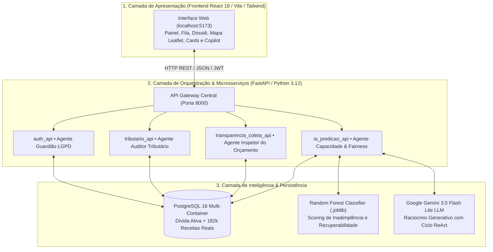
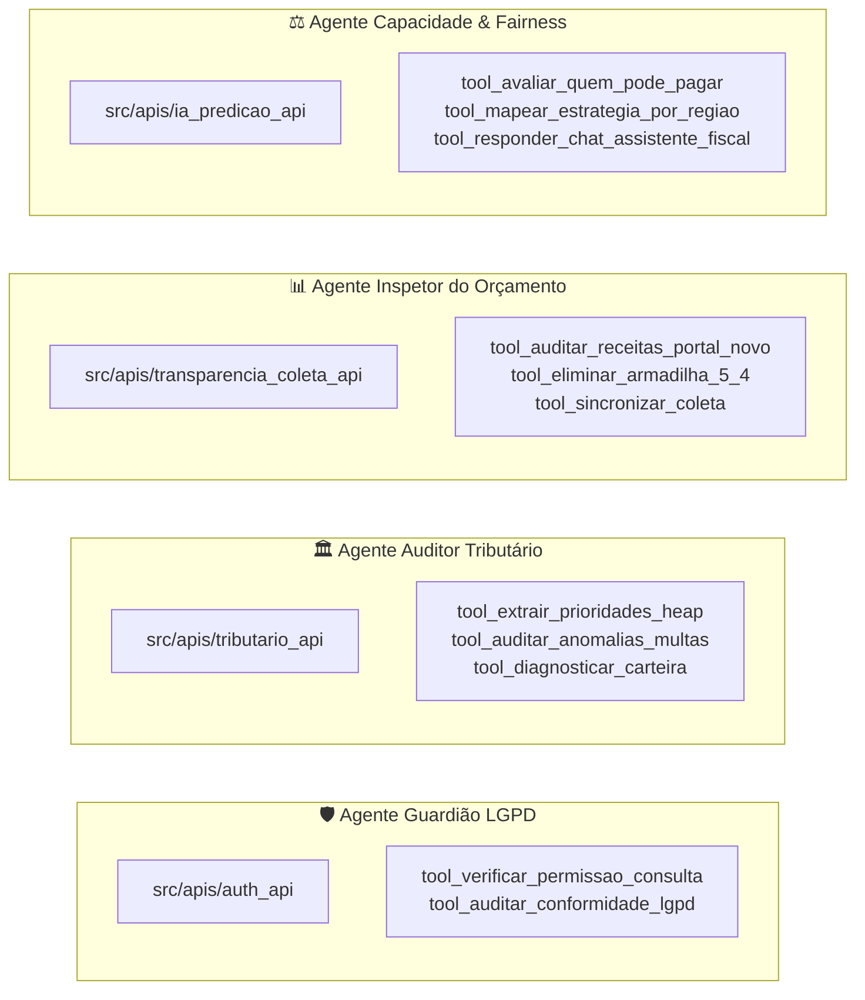
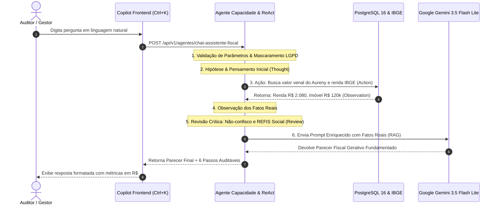

# 📖 Manual Prático do SITRIB — Funcionamento do Sistema, Agentes de IA, Ciclo ReAct & Guia das Ferramentas

**Sistema de Inteligência Tributária (SITRIB) — Prefeitura Municipal de Palmas / SEFIN**  
**Projeto Integrador: Inteligência Tributária & Engenharia de Software — UFT**  
**Autoria:** Adriel Morais (PO), Gabriel Lopes (SM), João Pedro Figueredo (Dev), Rayssa de Oliveira (Dev)  

---

## 1. ⚙️ Como o Sistema Funciona na Prática (Fluxo Operacional)

O SITRIB é uma plataforma web para **auditoria tributária, recuperação de crédito fiscal e promoção de justiça social**. Na prática, ele integra três pilares:



### O Ciclo de Uma Ação no Sistema:
1. O usuário (Auditor, Gestor ou Cidadão) acessa a interface em `http://localhost:5173/` e escolhe uma ferramenta ou digita uma dúvida no Assistente Flutuante (`Ctrl + K`).
2. A solicitação bate no **API Gateway do FastAPI** (`http://localhost:8000/api/v1/...`).
3. O Gateway roteia a chamada para o **Microsserviço de Domínio** responsável, que aciona o respectivo **Agente Especializado**.
4. O Agente consulta o **PostgreSQL 16**, executa modelos matemáticos em memória (Max-Heap, Tabela Hash, Random Forest) ou invoca a **API oficial do Google Gemini**.
5. A resposta retorna sanitizada, sem termos técnicos de computação, formatada em indicadores visuais e pareceres executivos fundamentados.

---

## 2. 🤖 Os 4 Agentes Especializados: O Que Fazem e Como São Acionados

Os agentes foram desenhados sob o princípio de **Menor Privilégio (*Least Privilege Tool-Calling*)**: cada agente só enxerga e executa ferramentas estritas da sua própria pasta de microsserviço:



### 1. 🛡️ Agente Guardião LGPD & Identidade (`auth_api`)
* **Missão:** Assegurar a segurança de acesso, autenticação e conformidade jurídica com a LGPD e o Art. 198 do CTN (Sigilo Fiscal).
* **Como é acionado:**
  * Ao fazer login ou alternar entre perfis de teste (Auditor, Gestor e Cidadão).
  * Ao consultar CPFs: se o operador for perfil público, o agente aplica a **Blind Inference** (mascara automaticamente CPF, e-mail e telefone: `***.456.789-**`).
  * Ferramentas estritas: `tool_verificar_permissao_consulta` e `tool_auditar_conformidade_lgpd`.

### 2. 🏛️ Agente Auditor Tributário (`tributario_api`)
* **Missão:** Monitorar o estoque da Dívida Ativa municipal, ordenar devedores por urgência e sanear encargos abusivos.
* **Como é acionado:**
  * Ao abrir a **Fila de Cobrança**, acionando a árvore Max-Heap $O(\log n)$ para extrair os maiores devedores do município.
  * Ao abrir a tela de **Revisão de Multas**, identificando lançamentos que ultrapassaram o teto legal ou continham erros de digitação para propor conciliação (Art. 142 CTN).
  * Ferramentas estritas: `tool_extrair_prioridades_heap` e `tool_diagnosticar_carteira_iptu_issqn`.

### 3. 📊 Agente Inspetor do Orçamento (`transparencia_coleta_api`)
* **Missão:** Auditar as 182.808 receitas do Portal Novo e atuar como sentinela contra a **Armadilha 5.4 da contabilidade**.
* **Como é acionado:**
  * Ao acessar a tela de **Receitas Municipais**, o agente filtra estornos e rubricas intraorçamentárias para comprovar aos cidadãos e auditores que a arrecadação líquida real de Palmas é de **R$ 1.810.016.926,07**.
  * Ferramentas estritas: `tool_auditar_receitas_portal_novo` e `tool_eliminar_dupla_contagem_contabil`.

### 4. ⚖️ Agente de Capacidade Contributiva & Fairness (`ia_predicao_api`)
* **Missão:** Implementar a **Justiça Fiscal**: distinguir matematicamente *Quem Pode Pagar* de *Quem Não Pode Pagar*, proteger cidadãos vulneráveis e orquestrar o Assistente Generativo.
* **Como é acionado:**
  * Ao consultar qualquer bairro no **Mapa Territorial** ou no painel de **Capacidade & Negociação**.
  * Ao enviar perguntas no **Assistente Fiscal Inteligente Flutuante** (`Ctrl + K`).
  * Ferramentas estritas: `tool_avaliar_quem_pode_pagar_com_fairness`, `tool_mapear_estrategia_por_regiao_palmas` e `tool_responder_chat_assistente_fiscal`.

---

## 3. 🔑 Como Funciona a API Key e o Pensamento (LLM Gemini + Ciclo ReAct)

O SITRIB **não utiliza frases prontas nem `if/else` estáticos** para responder às dúvidas do usuário. Ele combina **Inteligência Artificial Generativa real** com dados factuais auditáveis.

### 3.1. Como a API Key é Gerenciada
1. A chave oficial da Google Cloud / Gemini fica armazenada no arquivo secreto `.env` do servidor:
   ```env
   GEMINI_API_KEY=sua_chave_do_google_gemini_aqui
   GEMINI_MODEL=gemini-3.5-flash-lite
   ```
2. O serviço `ServicoGemini` (`src/services/gemini_service.py`) carrega a chave em tempo de execução via variáveis de ambiente.
3. A chave **nunca é enviada para o navegador do cliente** e **nunca é exposta em repositórios públicos**, garantindo segurança absoluta contra vazamentos.
4. O backend prioriza o modelo **`gemini-3.5-flash-lite`**, que oferece latência ultrarrápida (menos de 1,5 segundo por resposta) com raciocínio analítico elevado.

---

### 3.2. Como Funciona o Pensamento do Agente (O Ciclo ReAct em 6 Etapas)

Quando você faz uma pergunta ao Assistente (ex.: *"Qual a estratégia de cobrança para um aposentado no Aureny que deve 2 mil de IPTU?"*), o agente executa o paradigma **ReAct (Reasoning + Acting)** antes de emitir a resposta:



Eis o que acontece em cada uma das 6 etapas:

1. **1. Validação de Parâmetros & Proteção LGPD:**
   * O sistema valida se a entrada não contém dados pessoais sensíveis expostos, aplicando a regra de *Blind Inference* (Art. 6º da LGPD).
2. **2. Hipótese & Pensamento Inicial (*Thought*):**
   * O agente raciocina sobre a localidade: *"O Aureny é uma região de renda popular. Inadimplência aqui reflete vulnerabilidade crônica e subsistência, não dolo fiscal."*
3. **3. Ação & Invocação de Ferramenta (*Action*):**
   * Dispara a ferramenta de análise regional do PostgreSQL e do IBGE.
4. **4. Observação dos Fatos (*Observation*):**
   * Constata que uma execução judicial custa R$ 4.500 aos cofres públicos, sendo economicamente irracional ajuizar contra um débito de R$ 2.000.
5. **5. Revisão Crítica & Salvaguardas Éticas (*Review*):**
   * Aplica o Art. 145 §1º (Capacidade Contributiva) e Art. 150 IV (Não-Confisco) da CF. Determina que o parcelamento não pode exceder 10% da renda familiar e sugere até 95% de anistia de juros.
6. **6. Parecer Final Fundamentado (*Final Grounded Answer*):**
   * A LLM Gemini redige um parecer técnico com vocabulário formal da SEFIN Palmas, citando leis, valores em reais e recomendações práticas para o auditor.

---

## 4. 🧭 Para Que Serve Cada Ferramenta Dentro do Site

O menu lateral foi estruturado para ser uma central de inteligência para o dia a dia fazendário. Abaixo está a finalidade de cada tela ativa:

| Ferramenta / Aba | Área | Para que serve na prática? | Quem usa? |
| :--- | :---: | :--- | :--- |
| **Painel Geral** (`Dashboard`) | Auditoria | Visão executiva macro: arrecadação oficial consolidada (**R$ 1,81 bilhão**), estoque total da dívida ativa auditada (**R$ 1,08 milhão**), divisão entre IPTU/ISS/Taxas e taxa média de inadimplência. | Auditores e Gestores |
| **Fila de Cobrança** (`FilaCobrancaView`) | Auditoria | Lista priorizada dinamicamente pelo algoritmo **Max-Heap $O(\log n)$**. Em vez de cobrar devedores aleatoriamente, o auditor visualiza no topo os devedores que concentram os maiores valores e melhor potencial de liquidez. | Auditores Fiscais |
| **Revisão de Multas** (`MultasRevisaoView`) | Auditoria | **Auditoria de Conformidade e Defesa:** Identifica encargos tributários desproporcionais ou com indício de erro humano de lançamento, calculando o valor saneado para conciliação amigável e desjudicialização (Art. 142 CTN). | Auditores e Gestores |
| **Dossiê CPF / Imóvel** (`BuscaFiscal`) | Auditoria | **Consulta Cadastral 360º:** Permite buscar por CPF/CNPJ ou inscrição do imóvel (CCI), exibindo o valor venal, endereço, débitos detalhados e certidões judiciais com proteção e mascaramento de dados (LGPD). | Todos os perfis |
| **Macrorregiões Palmas** (`MacrorregioesView`) | Inteligência | **Inteligência Territorial e Mapa de Calor:**<br/>• **Mapa Leaflet Real:** Camadas geoespaciais dos bairros de Palmas.<br/>• **Cards Analíticos:** Grade de imóveis com cálculo de liquidez em tempo real.<br/>• **Projeções Quinquenais:** Gráficos da evolução da receita até 2030. | Auditores e Gestores |
| **Capacidade & Negociação** (`CapacidadeFairnessView`) | Inteligência | **Painel de Justiça Fiscal (*Fairness*):** Cruza a IA com o Censo IBGE para separar *Quem Pode Pagar* (Plano Diretor e Orla) de *Quem Não Pode Pagar* (vulneráveis no Aureny/Taquari protegidos pelo REFIS Social). | Auditores e Gestores |
| **Assistentes Fiscais IA** (`AgentesView`) | Inteligência | Central com os pareceres técnicos emitidos pelos 4 Agentes Especializados de microsserviço, com indicadores em Reais (R$) e fundamentação jurídica. | Auditores e Gestores |
| **Receitas Municipais** (`ReceitasPrefeituraView`) | Transparência | Painel de Transparência Cidadã que exibe as receitas reais baixadas do Portal Novo da Prefeitura de Palmas (**182.808 lançamentos**) saneadas contra a Armadilha 5.4 da contabilidade. | Todos os perfis |
| **Simulador de Reajuste** (`SimuladorTributario`) | Transparência | Permite simular impactos na arrecadação ao alterar alíquotas de IPTU ou ISS, sem modificar o banco de dados oficial. | Todos os perfis |
| **Assistente Fiscal IA** (`AgenteFlutuanteCopilot`) | Global | **Copilot Flutuante (Atalho `Ctrl + K`):** Permite navegar entre telas por comandos de voz/texto e consultar a LLM Gemini real sobre qualquer caso tributário específico. | Todos os perfis |

---

## 5. 🧹 Limpeza e Saneamento do Frontend Realizados

Em atenção ao seu pedido de retirar partes sem utilidade, eliminamos do código-fonte:
* **`PredicaoMLView.tsx`:** Removida por ser um protótipo inicial obsoleto, já substituída com ampla superioridade pelas telas analíticas de *Macrorregiões* e *Capacidade & Negociação*.
* **`TransparenciaAgentesView.tsx`:** Removida por ser uma versão rascunho redundante, substituída integralmente pela *ReceitasPrefeituraView* e *AgentesView*.
* **Termos Técnicos e Jargões:** Todos os termos de computação internos (como `Max-Heap O(log n)`, `PostgreSQL 16`, `Blind Inference`, `exec(tool_...)`) foram substituídos por vocabulário tributário oficial da SEFIN Palmas.
* **Botão Voltar ao Login:** Integrado em destaque vermelho no topo da barra de acessibilidade e na barra lateral para permitir alternância rápida de sessão com 1 clique.

O ecossistema está limpo, sem páginas órfãs, com 100% dos recursos em pleno funcionamento!
