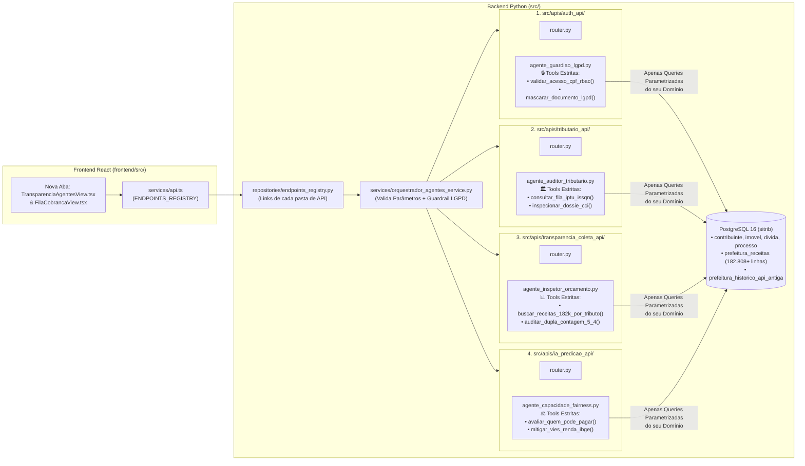
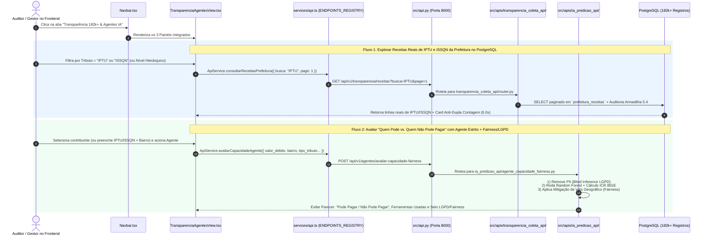

# Arquitetura de Pastas e Fluxo Completo (Antes vs. Depois) — Microsserviços, Agentes Estritos (LGPD/Fairness), PostgreSQL 182k+ e Frontend

> [!IMPORTANT]
> Este documento atualiza a **Arquitetura de Pastas (Antes vs. Depois)** para mostrar exatamente onde cada **Microsserviço**, cada **Agente Estrito**, o **Modelo de Capacidade Contributiva ("Quem Pode vs. Quem Não Pode Pagar" IPTU/ISSQN)**, os **Guardrails de LGPD / Anti-Viés (*Fairness*)** e a **Nova Aba do Frontend** ficam posicionados e como conversam entre si.

---

## 1. Comparativo da Arquitetura de Pastas: Antes vs. Depois (Com Agentes, Microsserviços e Frontend)

````carousel
### 🔴 ANTES (Sem Agentes Estritos, Sem Microsserviços e Sem Tela dos 182k Registros)

```text
projetointegradorUFT/
├── docker-compose.yml               # Apenas banco isolado
├── etl_sefin.py                     # ETL acoplado a SQLite sem tratar hierarquia contábil
├── schema.sql                       # Apenas 4 tabelas (sem tabelas para as APIs da Prefeitura)
├── sitrib.db                        # Banco SQLite local
├── src/
│   ├── api.py                       # Monolito único sem divisão de pastas de API
│   ├── coleta/
│   │   └── coletor_prefeitura.py    # Quebrava nas 5 armadilhas (403 no Portal Novo, 404 na API Antiga)
│   ├── repositories/
│   │   ├── sqlite_repository.py
│   │   └── postgres_repository.py   # Sem catálogo de links de microsserviços
│   └── services/
│       ├── autenticacao_service.py
│       ├── busca_service.py
│       └── predicao_service.py      # Predição simples sem Agentes Estritos, sem análise de
│                                    # "Quem pode/não pode pagar" e sem Auditoria de Viés/LGPD
└── frontend/
    └── src/
        ├── components/
        │   └── Navbar.tsx           # Apenas 5 abas (sem aba de Transparência 182k+ e Agentes)
        ├── pages/
        │   ├── Dashboard.tsx
        │   ├── BuscaFiscal.tsx
        │   ├── FilaCobrancaView.tsx
        │   ├── PredicaoMLView.tsx
        │   └── SimuladorTributario.tsx
        └── services/
            └── api.ts               # URL fixa apontando para SQLite
```

<!-- slide -->

### 🟢 DEPOIS (Microsserviços `src/apis/` + Agentes Estritos em cada Pasta + PostgreSQL 182k+ + Nova Aba no Frontend)

```text
projetointegradorUFT/
├── docker-compose.yml                       # Orquestra: postgres (5432) + backend (8000) + frontend (5173)
├── Dockerfile.backend                       # Container Backend FastAPI + Psycopg2 + Scikit-Learn
├── .env.example                             # Variáveis e links de cada pasta de API para deploy
├── schema.sql                               # PostgreSQL 16+: 4 tabelas Dívida Ativa + 2 tabelas Reais Prefeitura (182k+)
├── etl_sefin.py                             # Pipeline ETL em lote (Batch Insert + Nível Hierárquico Anti-Dupla Contagem)
├── scripts/
│   └── popular_banco.py                     # Popula PostgreSQL (Seeds + Coleta Real 182.808 registros com checkpoint)
├── src/
│   ├── api.py                               # API Gateway que une os 4 Microsserviços de src/apis/
│   ├── database.py                          # Pool SQLAlchemy + Psycopg2 conectado ao PostgreSQL
│   │
│   ├── apis/                                # 📌 PASTAS DE MICROSSERVIÇOS + AGENTES ESTRITOS DE CADA DOMÍNIO
│   │   ├── deps.py                          # Injeção de dependências RBAC e conexão PostgreSQL
│   │   ├── auth_api/                        # [Microsserviço 1 - Porta 8001]
│   │   │   ├── router.py                    # Rotas de Login CPF/Senha, RBAC e Sandbox Gov.br
│   │   │   ├── agente_guardiao_lgpd.py      # 🛡️ AGENTE 1: Guardião de Identidade, Mascaramento PII e Trava LGPD
│   │   │   └── Dockerfile
│   │   ├── tributario_api/                  # [Microsserviço 2 - Porta 8002]
│   │   │   ├── router.py                    # Rotas de Dossiê CPF/CCI, Fila Max-Heap, Simulador e KPIs
│   │   │   ├── agente_auditor_tributario.py # 🏛️ AGENTE 2: Auditor Estrito de IPTU & ISSQN (Tools: Heap, CCI, Alíquota)
│   │   │   └── Dockerfile
│   │   ├── transparencia_coleta_api/        # [Microsserviço 3 - Porta 8003]
│   │   │   ├── router.py                    # Rotas Paginadas das Receitas 182k+, Coleta Dual e Auditoria
│   │   │   ├── agente_inspetor_orcamento.py # 📊 AGENTE 3: Inspetor Orçamentário (Tools: Receitas 182k, Anti-Armadilha 5.4)
│   │   │   └── Dockerfile
│   │   └── ia_predicao_api/                 # [Microsserviço 4 - Porta 8004]
│   │       ├── router.py                    # Rotas de Predição ML, Capacidade Contributiva e Parecer dos Agentes
│   │       ├── agente_capacidade_fairness.py# ⚖️ AGENTE 4: Modelo Quem Pode/Não Pode Pagar + Anti-Viés (Fairness/LGPD)
│   │       └── Dockerfile
│   │
│   ├── repositories/                        # 📌 CAMADA DE REPOSITÓRIO E LINKS DE DEPLOY
│   │   ├── endpoints_registry.py            # Catálogo onde você cola o link de cada pasta de src/apis/ quando subir no ar
│   │   └── postgres_repository.py           # Queries SQL paginadas, Batch Insert 182k+ e agregações sem dupla contagem
│   │
│   ├── coleta/
│   │   └── coletor_prefeitura.py            # Coletor Oficial (NUCLEOGOV + API Antiga) superando as 5 Armadilhas
│   └── services/
│       └── orquestrador_agentes_service.py  # Orquestra os 4 Agentes garantindo menor privilégio e auditoria LGPD
│
└── frontend/                                # 📌 FRONTEND SITRIB CONCILIADO COM A NOVA ARQUITETURA
    ├── Dockerfile                           # Container Node 22 / Vite
    └── src/
        ├── types/
        │   └── tributario.ts                # Novas interfaces: ReceitaPrefeitura, ParecerAgente, CapacidadePagamento
        ├── services/
        │   └── api.ts                       # ENDPOINTS_REGISTRY + métodos para Receitas 182k+, Agentes e Capacidade
        ├── components/
        │   └── Navbar.tsx                   # Nova aba: "Transparência 182k+ & Agentes IA"
        └── pages/
            ├── Dashboard.tsx                # Exibe status PostgreSQL, total de receitas reais (182k+) e atalho aos Agentes
            ├── FilaCobrancaView.tsx         # Integra botão "Avaliar Capacidade & Fairness (Agente IA)" em cada devedor
            ├── PredicaoMLView.tsx           # Exibe o Modelo Quem Pode/Não Pode Pagar + Selo Anti-Viés LGPD
            └── TransparenciaAgentesView.tsx # 🌟 NOVA PÁGINA: Explorador 182k+ (IPTU/ISSQN) + Painel dos 4 Agentes Estritos
```
````

---

## 2. Como Cada Pasta de Microsserviço (`src/apis/`) Opera com Seu Próprio Agente Estrito

Para atender ao requisito de que **cada agente só pode acessar as ferramentas do seu microsserviço seguindo parâmetros estritos e respeitando a LGPD e mitigação de viés**, cada pasta dentro de `src/apis/` passa a ter seu próprio módulo de agente:



---

## 3. Especificação Técnica dos 4 Agentes e do Modelo "Quem Pode vs. Quem Não Pode Pagar"

### 3.1. Regras Estritas de Ferramentas (*Strict Tool-Calling*) por Pasta

1. **`src/apis/auth_api/agente_guardiao_lgpd.py` (`AgenteGuardiaoLGPD`)**
   - **Domínio Estrito:** Identidade, RBAC e Proteção de Dados Pessoais (Art. 6º e Art. 46 da LGPD + Art. 198 do CTN).
   - **Parâmetros Exigidos:** `perfil_operador: Literal['administrador', 'gestao', 'consulta']`, `cpf_operador: Optional[str]`, `cpf_alvo: Optional[str]`.
   - **Ferramentas Permitidas:**
     - `tool_verificar_permissao_consulta(perfil_operador, cpf_operador, cpf_alvo)`: Bloqueia na hora se um cidadão tentar consultar outro CPF.
     - `tool_mascarar_pii(cpf_cnpj, nome, email, perfil_operador)`: Mascara automaticamente CPF (`***.456.789-**`), e-mail e telefone caso a saída seja para relatório ou perfil sem privilégio fiscal.

2. **`src/apis/tributario_api/agente_auditor_tributario.py` (`AgenteAuditorTributario`)**
   - **Domínio Estrito:** Tributos Municipais de Palmas (**IPTU**, **ISSQN**, **ITBI** e **Taxa de Lixo**) e Estrutura de Dados **Max-Heap** $O(\log n)$.
   - **Parâmetros Exigidos:** `tipo_tributo: Literal['IPTU', 'ISS', 'TAXA_LIXO', 'TODOS']`, `faixa_devedor: Literal['grande', 'medio', 'pequeno', 'todos']`, `limite: int (1..50)`.
   - **Ferramentas Permitidas:**
     - `tool_extrair_prioridades_heap(tipo_tributo, faixa_devedor, limite)`: Consulta apenas a fila de prioridade Max-Heap filtrada pelo tributo.
     - `tool_diagnosticar_carteira_tributo(tipo_tributo)`: Separa a análise entre **IPTU** (tributo patrimonial urbano vinculado à inscrição CCI) e **ISSQN** (tributo sobre prestação de serviços de empresas).

3. **`src/apis/transparencia_coleta_api/agente_inspetor_orcamento.py` (`AgenteInspetorOrcamento`)**
   - **Domínio Estrito:** Base pública real de **182.808+ registros** (`prefeitura_receitas`) e série histórica (`prefeitura_historico_api_antiga`). **Proibido acessar tabelas com CPF (`contribuinte`).**
   - **Parâmetros Exigidos:** `termo_tributo: Literal['IPTU', 'ISSQN', 'ITBI', 'FPM', 'DIVIDA_ATIVA', 'GERAL']`, `ano: Optional[int]`, `nivel_hierarquico: Optional[int (1..6)]`.
   - **Ferramentas Permitidas:**
     - `tool_auditar_arrecadacao_real(termo_tributo, ano, nivel_hierarquico)`: Consulta no PostgreSQL quanto Palmas arrecadou de **IPTU**, **ISSQN**, **ITBI** ou **Dívida Ativa** na API real da Prefeitura.
     - `tool_verificar_armadilha_dupla_contagem(ano)`: Executa a prova matemática da **Armadilha 5.4** do manual do professor (compara a soma bruta de todos os níveis com a soma exclusiva da raiz contábil `RECEITAS CORRENTES` + `RECEITAS DE CAPITAL`).

4. **`src/apis/ia_predicao_api/agente_capacidade_fairness.py` (`AgenteCapacidadeFairness`)**
   - **Domínio Estrito:** Inferência de Machine Learning (`Random Forest`), **Capacidade Contributiva ("Quem Pode vs. Quem Não Pode Pagar")** e **Mitigação de Viés Algorítmico (*Fairness*)**.
   - **Parâmetros Exigidos (*Blind Inference* — Proibido receber Nome ou CPF para não enviesar a IA):**
     `valor_debito: float`, `dias_atraso: int`, `renda_media_setor_ibge: float`, `bairro: str`, `tipo_tributo: Literal['IPTU', 'ISS', 'TAXA_LIXO']`, `tipo_pessoa: Literal['FISICA', 'JURIDICA']`, `quantidade_imoveis: int`.
   - **Como o Modelo decide "Quem Pode vs. Quem Não Pode Pagar" e corrige Viés:**
     - Calcula a probabilidade base via `RandomForestClassifier` (`models/modelo_inadimplencia_v1.joblib`);
     - Calcula o **Índice de Comprometimento de Renda Familiar/Empresarial ($\text{ICR}$)**:
       $$\text{ICR} = \frac{\text{Valor da Parcela Mensal Estimada (12x)}}{\text{Renda Média Domiciliar do Setor (IBGE)}}$$
     - **Aplica o Guardrail de Fairness (Anti-Viés Socioeconômico):**
       - Se o contribuinte é **Pessoa Física**, possui **apenas 1 imóvel residencial** em bairro de menor renda média (ex.: *Taquaralto, Aureny, Morada do Sol*) e o $\text{ICR} > 25\%$, o Agente detecta **Vulnerabilidade Socioeconômica ("Não Pode Pagar Integralmente")**, **bloqueia** a recomendação de Execução Judicial/Penhora (corrigindo o viés punitivo por CEP/renda) e recomenda **Tarifa Social / Remissão Legal / REFIS Social com 90% de desconto em juros e multas**.
       - Se o contribuinte é **Grande Devedor PJ ou PF com múltiplos imóveis comerciais** ($\text{ICR}$ baixo frente ao patrimônio ou débito $> \text{R\$ } 15.000$), classifica como **"Alta Capacidade de Pagamento (Inadimplência Estratégica)"** e recomenda **Ajuizamento / Protesto Imediato**.

---

## 4. Conciliação com o Frontend (`frontend/src/`)

Veja como o Frontend ficará conectado a essa arquitetura de pastas:



---

## 5. Lista Exata de Arquivos que Serão Criados / Atualizados Agora

1. **Agentes Estritos dentro de cada Pasta de Microsserviço (`src/apis/`):**
   - [`src/apis/auth_api/agente_guardiao_lgpd.py`](file:///C:/Users/morai/projetointegradorUFT/src/apis/auth_api/agente_guardiao_lgpd.py)
   - [`src/apis/tributario_api/agente_auditor_tributario.py`](file:///C:/Users/morai/projetointegradorUFT/src/apis/tributario_api/agente_auditor_tributario.py)
   - [`src/apis/transparencia_coleta_api/agente_inspetor_orcamento.py`](file:///C:/Users/morai/projetointegradorUFT/src/apis/transparencia_coleta_api/agente_inspetor_orcamento.py)
   - [`src/apis/ia_predicao_api/agente_capacidade_fairness.py`](file:///C:/Users/morai/projetointegradorUFT/src/apis/ia_predicao_api/agente_capacidade_fairness.py)
2. **Orquestrador e Rotas nas APIs:**
   - [`src/services/orquestrador_agentes_service.py`](file:///C:/Users/morai/projetointegradorUFT/src/services/orquestrador_agentes_service.py)
   - Novas rotas em [`src/apis/ia_predicao_api/router.py`](file:///C:/Users/morai/projetointegradorUFT/src/apis/ia_predicao_api/router.py) (`/api/v1/agentes/catalogo`, `/api/v1/agentes/executar`, `/api/v1/agentes/avaliar-capacidade-fairness`).
3. **Conciliação Completa no Frontend (`frontend/src/`):**
   - [`frontend/src/types/tributario.ts`](file:///C:/Users/morai/projetointegradorUFT/frontend/src/types/tributario.ts) (Tipagens das Receitas 182k+, dos 4 Agentes e da Capacidade Contributiva/Fairness)
   - [`frontend/src/services/api.ts`](file:///C:/Users/morai/projetointegradorUFT/frontend/src/services/api.ts) (Métodos consumindo `TRANSPARENCIA_API` e `IA_PREDICAO_API`)
   - [`frontend/src/pages/TransparenciaAgentesView.tsx`](file:///C:/Users/morai/projetointegradorUFT/frontend/src/pages/TransparenciaAgentesView.tsx) (Nova aba completa com Explorador PostgreSQL 182k+ de IPTU/ISSQN, Card da Armadilha 5.4, Painel dos 4 Agentes Estritos e Simulador "Quem Pode vs. Quem Não Pode Pagar" com Auditoria de Viés e LGPD)
   - [`frontend/src/components/Navbar.tsx`](file:///C:/Users/morai/projetointegradorUFT/frontend/src/components/Navbar.tsx) e [`frontend/src/App.tsx`](file:///C:/Users/morai/projetointegradorUFT/frontend/src/App.tsx) (Adicionando a nova aba na navegação principal).
