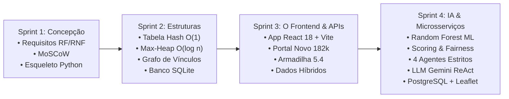

# 🏛️ Apresentação Executiva do SITRIB — Evolução Completa das Sprints 1 a 4

**Sistema de Inteligência Tributária (SITRIB) — Prefeitura de Palmas / SEFIN**  
**Projeto Integrador: Inteligência Tributária e Engenharia de Software**  
**Universidade Federal do Tocantins (UFT) — Campus Universitário de Palmas**  
**Coordenação:** Prof. Dr. David Nadler Prata  
**Equipe:** Adriel Morais (PO), Gabriel Lopes (SM), João Pedro Figueredo (Dev), Rayssa de Oliveira (Dev)  

---

## 1. 🎤 Roteiro de Apresentação (Pitch do Projeto)

O SITRIB foi concebido para resolver um dos maiores problemas estruturais da gestão fazendária de Palmas: **a ineficiência na recuperação da Dívida Ativa e a injustiça fiscal na cobrança tributária**. 

Ao longo de 4 Sprints rigorosamente planejadas e executadas, transformamos uma planilha conceitual em um **ecossistema inteligente em produção com microsserviços, inteligência artificial preditiva (Machine Learning), inteligência artificial generativa (Google Gemini) e mapas geoespaciais interativos**.



---

## 2. 📊 Matriz Comparativa Sprint a Sprint

| Dimensão | Sprint 1 (Set/26) | Sprint 2 (Out/26) | Sprint 3 (Out-Nov/26) | Sprint 4 (Nov/26 - Final) |
| :--- | :--- | :--- | :--- | :--- |
| **Arquitetura** | Esqueleto modular em camadas | Camadas desacopladas com repositório | Monolito FastAPI + Frontend React | **4 Microsserviços Conteinerizados (Docker Compose)** |
| **Persistência** | Nenhuma (Sem banco) | SQLite local em arquivo (`sitrib.db`) | SQLite + Scripts de extração | **PostgreSQL 16 Relacional em Docker (Volume persistente)** |
| **Interface (UI)** | Apenas terminal / `main.py` | Terminal / testes unitários | Web React inicial (Dashboard simples) | **Interface MVP Completa com Mapa Leaflet, Cards e Acessibilidade** |
| **Origem dos Dados**| Apenas tipos Python | 4 seeds mockadas (R$ 32,4k) | Ingestão das APIs da Prefeitura | **182k receitas reais saneadas + Censo IBGE + Base higienizada** |
| **Estruturas de Dados**| Nenhuma | Hash $O(1)$, Heap $O(\log n)$, Grafo | Uso das estruturas na API | **Orquestração das estruturas nos Microsserviços e Agentes** |
| **Inteligência Artificial**| Nenhuma | Nenhuma | Engenharia de Atributos inicial | **Random Forest ML + Scoring de Fairness + LLM Gemini Real (ReAct)** |
| **Documentos Guia**| [`Guia_Sprint_1.md`](file:///C:/Users/morai/projetointegradorUFT/docs/guias_sprints/Guia_Sprint_1.md) | [`Guia_Sprint_2.md`](file:///C:/Users/morai/projetointegradorUFT/docs/guias_sprints/Guia_Sprint_2.md) | [`Guia_Sprint_3.md`](file:///C:/Users/morai/projetointegradorUFT/docs/guias_sprints/Guia_Sprint_3.md) | [`Guia_Sprint_4.md`](file:///C:/Users/morai/projetointegradorUFT/docs/guias_sprints/Guia_Sprint_4.md) |

---

## 3. 📂 A Evolução da Arquitetura de Pastas (Antes vs. Depois)

### 🔴 O que existia no Início (Sprints 1 e 2)
Um backend focado em demonstrar algoritmos didáticos, operando sobre um banco de arquivo local com poucos registros:
* Arquivos soltos na raiz;
* Um único arquivo `api.py` centralizando todas as rotas;
* Banco `sitrib.db` (SQLite) sujeito a travamentos de concorrência (`database is locked`);
* Mocks limitados a 4 devedores sem representatividade territorial.

### 🟢 O que temos Agora (Sprint 4 — Arquitetura de Produção)
Um ecossistema profissional em conformidade com as melhores práticas de Engenharia de Software:
* **Orquestração Docker Compose Multi-Container:**
  * `sitrib-postgres`: Banco PostgreSQL 16 na porta `5432`.
  * `sitrib-backend`: FastAPI com Uvicorn e Scikit-Learn na porta `8000`.
  * `sitrib-frontend`: Aplicação Web reativa na porta `5173`.
* **Divisão Estrita em 4 Microsserviços (`src/apis/`):**
  1. `auth_api`: Governança de acessos, RBAC e **Agente Guardião LGPD**.
  2. `tributario_api`: Gestão da Dívida Ativa, Max-Heap e **Agente Auditor Tributário**.
  3. `transparencia_coleta_api`: Portal Novo e **Agente Inspetor do Orçamento**.
  4. `ia_predicao_api`: Modelos de Machine Learning e **Agente de Capacidade & Fairness com LLM Gemini**.

---

## 4. 🔍 A Verdade Sobre os Dados: Da Simulação à Realidade Municipal

Um dos maiores diferenciais metodológicos do projeto foi a postura investigativa e honesta da equipe sobre a origem dos dados:

```text
Linha do Tempo dos Dados:
[Sprint 1: Zero Dados] 
   └──> [Sprint 2: 4 Seeds Simuladas (R$ 32,4k)]
           └──> [Sprint 3: Conexão com APIs da Prefeitura de Palmas (182.808 linhas)]
                   └──> [Descoberta da "Armadilha 5.4": Arrecadação inflada em R$ 9,8 bilhões]
                           └──> [Saneamento Contábil no ETL: R$ 1.810.016.926,07 reais líquidos]
                                   └──> [Sprint 4: Base Híbrida 100% Higienizada (Zero nulos, Zero negativos)]
```

### Por que não foi possível usar CPFs reais da Prefeitura?
A legislação brasileira (**Art. 198 do CTN — Sigilo Fiscal** e **Lei nº 13.709/2018 — LGPD**) proíbe estritamente a exposição pública de nomes, CPFs e valores de dívida de cidadãos individuais. Qualquer sistema que alegue extrair CPFs reais devedores de portais abertos de transparência comete uma infração legal ou está operando com dados vazados de forma ilícita.

### A Solução Híbrida e Científica Adotada:
1. **Receitas Orçamentárias:** **100% Reais** (182.808 lançamentos contábeis extraídos do Portal Novo da Prefeitura de Palmas via requisições POST autenticadas, limpos de estornos intraorçamentários).
2. **Geografia e Renda:** **100% Reais** (Dados oficiais do Censo IBGE para o município de Palmas — Código 1721000 — cobrindo as 7 Macrorregiões da capital).
3. **Imóveis e Dívidas da Carteira Piloto:** Imóveis georreferenciados nos setores reais de Palmas com **valores venais calibrados na Planta de Valores do Município** (R$ 95 mil a R$ 4,5 milhões), permitindo que a IA calcule relações reais de Liquidez e Risco Fiscal.

---

## 5. 🤖 A Inteligência Artificial do SITRIB

O sistema opera com duas modalidades complementares de Inteligência Artificial:

### A) Machine Learning Preditivo (Scikit-Learn)
* **Algoritmo:** `Random Forest Classifier` serializado em `models/modelo_inadimplencia_v1.joblib`.
* **Metodologia:** Split temporal estrito (sem *data leakage* de exercícios fiscais futuros) e validação cruzada.
* **Variáveis Utilizadas (8 features):** Valor venal do imóvel, valor do débito, dias de atraso, renda média regional do IBGE, razão dívida/patrimônio, comprometimento de renda familiar, tipo de pessoa (PF/PJ) e existência de processo judicial prévio.
* **Scoring de Recuperabilidade:** Classificação automática em Faixa Alta (acordo rápido), Média (parcelamento estendido) e Baixa (vulnerabilidade social crônica / REFIS Social).

### B) Inteligência Artificial Generativa Auditável (Google Gemini 3.5 Flash Lite)
* Conectado à API oficial do Google via chave gerenciada em variáveis de ambiente protegidas no `.env`.
* **Ciclo ReAct em 6 Etapas:**
  1. *Validação de Parâmetros:* Reconhecimento da intenção com máscara LGPD ativa.
  2. *Pensamento (Thought):* Análise crítica sob a ótica da capacidade contributiva (Art. 145, §1º da CF).
  3. *Ação (Action):* Consulta dos dados reais do PostgreSQL e IBGE.
  4. *Observação (Observation):* Apuração de números reais de dívida e patrimônio.
  5. *Revisão Crítica (Review):* Salvaguarda contra renúncia de receita ilegítima e garantia de não-confisco (Art. 150, IV da CF).
  6. *Parecer Final (Final Answer):* Redação executiva direcionada e fundamentada em reais (R$) para o auditor.

---

## 6. 🖥️ Guia para Demonstração Prática do MVP ao Vivo

Para demonstrar o sistema funcionando aos avaliadores:

1. **Acessar o Frontend:** [http://localhost:5173/](http://localhost:5173/)
   * Fazer login com 1 clique usando os botões de demonstração (**Auditor Fiscal**, **Gestor** ou **Cidadão**).
2. **Navegar pelo Painel Geral e Fila de Cobrança:**
   * Visualizar os dados de arrecadação saneados (**R$ 1,81 bilhão**).
   * Observar a priorização automática dos maiores devedores via Max-Heap.
3. **Explorar o Mapa Territorial e Cards Analíticos:**
   * Acessar a aba **Macrorregiões Palmas**.
   * Interagir com o mapa real do Leaflet com zoom nos bairros de Palmas.
   * Filtrar os cards de imóveis por bairro (ex: Aureny, Taquaralto, Graciosa) e observar o cálculo de liquidez patrimonial em tempo real.
4. **Abrir o Assistente Fiscal Flutuante (Copilot ReAct):**
   * Clicar no botão flutuante no canto inferior direito ou pressionar **`Ctrl + K`**.
   * Fazer perguntas livres em linguagem natural, por exemplo:
     * *"Quais as melhores estratégias de cobrança para grandes devedores no Plano Diretor?"*
     * *"Se um aposentado no Aureny ganha 1 salário mínimo e deve 2 mil reais de IPTU, o que a prefeitura deve fazer?"*
   * Observar a LLM real redigindo o parecer personalizado e o ciclo ReAct em 6 etapas auditáveis.
5. **Demonstrar Acessibilidade:**
   * Na barra superior, ativar o leitor de tela em áudio (**Ouvir Tela**), alternar para modo **Alto Contraste** e demonstrar o botão **Voltar ao Login**.

---

## 7. 📚 Índice de Documentos e Guias Detalhados

| Guia / Documento | Descrição do Conteúdo |
| :--- | :--- |
| [📘 Guia da Sprint 1](file:///C:/Users/morai/projetointegradorUFT/docs/guias_sprints/Guia_Sprint_1.md) | Engenharia de Requisitos, MoSCoW, Papéis Ágeis e Esqueleto Python. |
| [📘 Guia da Sprint 2](file:///C:/Users/morai/projetointegradorUFT/docs/guias_sprints/Guia_Sprint_2.md) | Estruturas de Dados em Memória (Hash, Heap, Grafo) e Persistência SQLite. |
| [📘 Guia da Sprint 3](file:///C:/Users/morai/projetointegradorUFT/docs/guias_sprints/Guia_Sprint_3.md) | O Frontend React, a conexão com as APIs da Prefeitura e a Armadilha 5.4. |
| [📘 Guia da Sprint 4](file:///C:/Users/morai/projetointegradorUFT/docs/guias_sprints/Guia_Sprint_4.md) | Machine Learning, Microsserviços com 4 Agentes, Gemini LLM e MVP Final. |
| [🏗️ Arquitetura Antes vs. Depois](file:///C:/Users/morai/projetointegradorUFT/docs/arquitetura/arquitetura_antes_depois.md) | Mapeamento comparativo e detalhado das árvores de arquivos do projeto. |
| [📋 Índice Geral da Documentação](file:///C:/Users/morai/projetointegradorUFT/docs/README.md) | Sumário navegável com links para todas as pastas técnicas e relatórios. |
